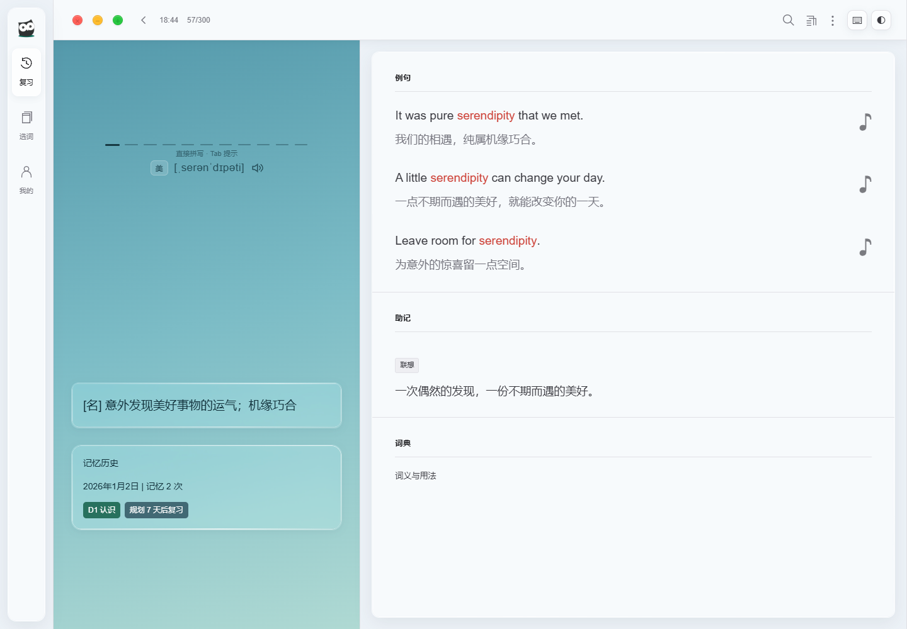
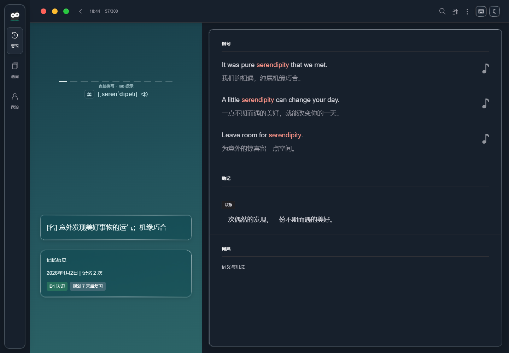
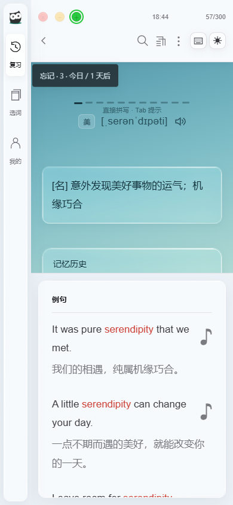
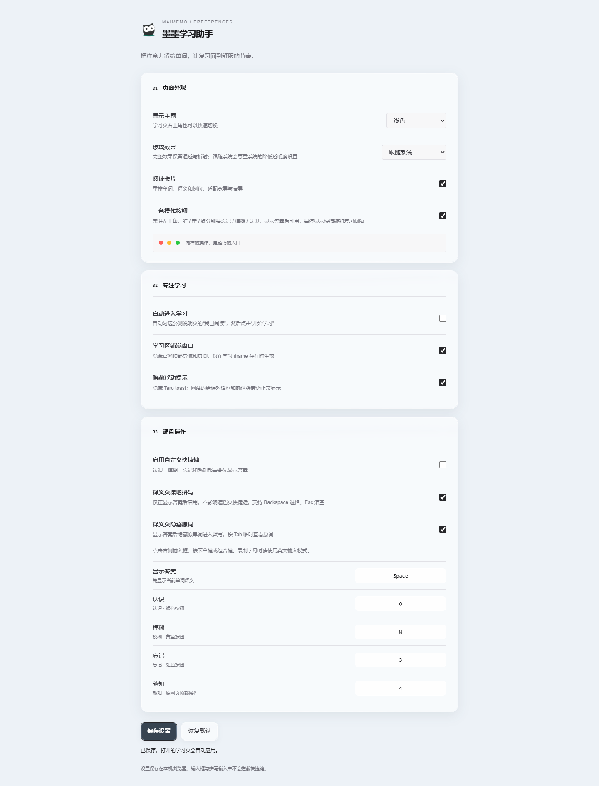

# 墨墨学习助手

面向墨墨背单词网页版的浏览器扩展（Firefox / Zen / Chrome / Edge），提供可配置快捷键、释义页原地拼写、三色操作按钮、专注布局和明暗主题。

详细开发与版本记录见 [开发与测试](CONTRIBUTING.md) · [版本记录](CHANGELOG.md) · [第三方许可证](docs/third-party-licenses.txt)。

## 预览

| 学习页（浅色） | 学习页（深色） |
| :---: | :---: |
|  |  |

| 窄屏 390px | 设置页 |
| :---: | :---: |
|  |  |

## 功能

- **键盘快捷键**：支持自定义“显示答案 / 认识 / 模糊 / 忘记 / 熟知”，按住不重复触发，输入框与中文输入法中自动让路。
- **释义页原地拼写**：显示答案后在原单词位置直接敲键盘拼写（默认隐藏原词进入默写，`Tab` 临时查看原词，`Backspace` 退格，`Esc` 清空）；遮挡页不拦截按键；拼写完成后自动把键盘权限交还给记忆快捷键。
- **三色操作按钮**：左上角常驻 **忘记 / 模糊 / 认识**，悬停显示快捷键与复习间隔，返回上一词时高亮已选状态。
- **专注布局与主题**：隐藏官网导航和页脚，支持跟随系统 / 浅色 / 深色与 Liquid Glass 玻璃效果（可在顶部工具栏、弹窗或设置页随时切换）。
- **自动进入**：自动勾选公测说明页“我已阅读”并点击“开始学习”。

## 默认快捷键

| 按键 | 动作 |
| --- | --- |
| `Space` | 显示答案 |
| `1` | 认识 |
| `2` | 模糊 / 不确定 |
| `3` | 忘记 / 不认识 |
| `4` | 熟知 |

## 0.3.13 浏览器版本

| 浏览器 | 开发载入目录 | 发布安装包 |
| --- | --- | --- |
| Firefox / Zen | `dist/firefox` | `maimemo-keyboard-helper-firefox-0.3.13.zip` |
| Chrome / Edge | `dist/chromium` | `maimemo-keyboard-helper-chromium-0.3.13.zip` |

- **Firefox / Zen**：打开 `about:debugging#/runtime/this-firefox` → “临时载入附加组件”，选择 `dist/firefox/manifest.json`（或 Firefox ZIP）。
- **Chrome / Edge**：打开 `chrome://extensions` 或 `edge://extensions`，开启“开发者模式” → “加载已解压的扩展程序”，选择 `dist/chromium`（或解压后的 Chromium ZIP 目录）。

两个版本都需先停用 Tampermonkey 中原来的脚本，然后打开 `https://www.maimemo.com/home/web_study` 或 `https://tc-apis.maimemo.com/webstudy/app` 使用。

## 本地开发与验证

需要 Node.js 22.15+（运行时已内置预编译的 `content/liquid-glass.js`，仅开发和打包需要 npm）：

```sh
npm ci --ignore-scripts
npm run build
npm test
npm run check
npm run zip
```

- `npm run test:browser` / `npm run test:browser:chromium`：Playwright 模拟页面回归测试。
- `npm run test:extension`：加载真实 `dist/chromium` 扩展的原生回归测试。

## 权限与许可

仅申请 `storage` 权限，仅在墨墨学习页生效，只保存主题、开关和快捷键设置，不读取账号凭证或学习数据。项目源码采用 MIT License（[LICENSE](LICENSE)）。
